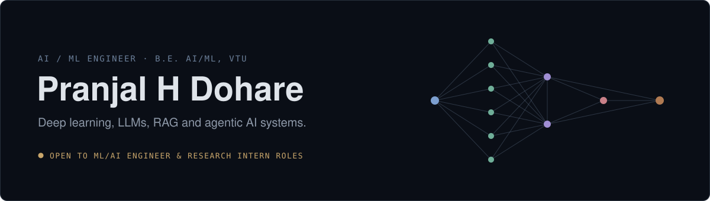

 

## About

Final-year undergraduate at Acharya Institute of Technology. I work on LLMs, RAG, MCP, agentic AI systems and applied ML research.
I'm looking for ML/AI Engineer roles (intern or new grad) and research-adjacent roles such as applied scientist or research intern.

 

## Projects

### Agentic SRE OpenEnv

**A reinforcement learning environment that drops agents into simulated production incidents and scores their response the way an on-call rotation would judge a human.**

The policy model is GLM-5.2 (open-weight). It uses hybrid memory (pgvector plus a Postgres causal graph), tools wrapped in MCP, and a ToRA-style planning loop.

[GitHub](https://github.com/Pranjal1342/Agentic_SRE) · [Hugging Face](https://huggingface.co/LordofMonarchs/Agentic_SRE)

### Tri-Branch Fusion CNN: Oral Cancer Screening

**Validation accuracy: 72.02%.**

My capstone (BAI685): non-invasive oral cancer screening that pairs autofluorescence imaging (AFI) with edge AI. It fuses three branches (a WLI RGB CNN, an AFI grayscale CNN and a metadata MLP) and targets sub-200 ms INT8 TFLite inference on an ESP32-S3.

[Repository](https://github.com/Pranjal1342/Oral_Sense)

 

## Skills

 **Deep Learning:** CNNs (ResNet/EfficientNet/MobileNet), transfer learning, segmentation/detection, RNN/LSTM, quantization/pruning/distillation, TFLite/ONNX 
 **Machine Learning:** regression, SVM, decision trees, random forest/XGBoost, clustering, PCA/t-SNE, feature engineering, model evaluation, RL (MDPs, Q-learning, policy gradients) 
 **LLMs:** transformer internals (self/multi-head attention, positional encoding, encoder-decoder vs. decoder-only), prompting/few-shot, LoRA/PEFT, quantization, batching, KV cache 
 **RAG:** Graph RAG, semantic search, hybrid agentic + graph RAG 
 **MCP:** MCP servers (tools/resources), multi-tool orchestration, agent-to-API wiring 
 **Agentic AI:** agent harnesses, short/long-term memory, tool use, planning loops, RL-trained SRE agent 
 **Backend:** Python, Java, Flask, FastAPI 
 **Frontend:** HTML, CSS, JavaScript, React

 

## Recent Activity

<!-- ACTIVITY:START -->
_Filled in by the Recent Activity workflow._
<!-- ACTIVITY:END -->

 

## Contact

- Email: [pranjaldohare8@gmail.com](mailto:pranjaldohare8@gmail.com)
- GitHub: [github.com/Pranjal1342](https://github.com/Pranjal1342)
- LinkedIn: [linkedin.com/in/pranjal-dohare-892b262a6](https://www.linkedin.com/in/pranjal-dohare-892b262a6/)
- X: [x.com/PranjalDohare19](https://x.com/PranjalDohare19)
- Portfolio: [pranjaldohare.vercel.app](https://pranjaldohare.vercel.app/)
